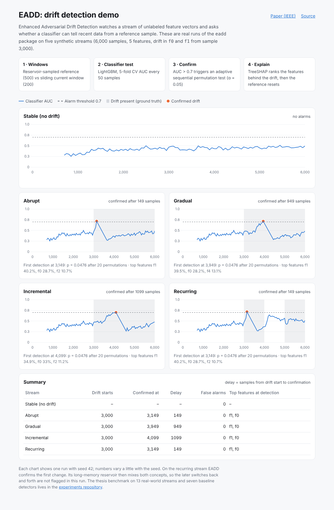

# EADD: Enhanced Adversarial Drift Detection

[](https://github.com/NusratBegum/eadd/actions/workflows/ci.yml)
[](https://ieeexplore.ieee.org/document/11596765)

Unsupervised feature drift detection for ML monitoring: EADD tells you **when** the input distribution of a model has changed and **which features** changed, without needing labels.

**Live demo:** https://eadd-demo.vercel.app · **Paper:** [Enhanced Adversarial Drift Detection for MLOps Feature Monitoring (JCSSE 2026, IEEE)](https://ieeexplore.ieee.org/document/11596765)



This is the detector from my M.Sc. thesis at the Faculty of ICT, Mahidol University (*Feature Drift Detection via Discriminative Classification*, 2026), packaged as a standalone library. The full benchmark (8 detectors, 13 real-world streams) lives in [unsupervised-concept-drift-detection](https://github.com/NusratBegum/unsupervised-concept-drift-detection).

## How it works

```
stream ─▶ reservoir-sampled reference W_ref (500) + sliding current W_cur (200)
       ─▶ every 50 samples: LightGBM classifier two-sample test, 5-fold CV AUC
       ─▶ AUC > 0.7 ?  ─▶ adaptive sequential permutation test (≤199 permutations, α = 0.05)
       ─▶ p < α ?      ─▶ drift confirmed: TreeSHAP feature ranking, reset W_ref
```

1. **Classifier two-sample test:** if a classifier can separate reference from current samples (AUC well above 0.5), the distributions differ.
2. **Reservoir-sampled reference:** a uniform sample of everything since the last drift. This long memory is what lets EADD catch slow gradual and incremental drift that sliding-window detectors miss.
3. **Adaptive sequential permutation test (ASPT):** confirms an alarm with as few permutations as the evidence allows. A clear drift stops after 20 of 199.
4. **TreeSHAP attribution:** ranks the features that drive the separation, so the alarm says where to look.
5. **Prediction entropy** of the discriminator is tracked as an early-warning signal.

## Usage

```bash
pip install "eadd[shap] @ git+https://github.com/NusratBegum/eadd"
```

```python
from eadd import EADD

detector = EADD(seed=42)          # defaults match the thesis: 500/200 windows, AUC 0.7, 199 permutations
for t, row in enumerate(stream):  # row: {"feature_name": value, ...}
    if detector.update(row):
        report = detector.get_last_report()
        print(t, report["auc"], report["p_value"], report["feature_importances"])
```

`get_last_report()` returns the AUC, permutation p-value, permutations used, prediction entropy (and its trend), and the feature ranking in percent.

## Results

From the thesis (Chapter 4), which compares EADD with seven unsupervised detectors from the [Lukats et al. (2024)](https://link.springer.com/article/10.1007/s41060-024-00620-y) benchmark, including D3 and SPLL:

- **Synthetic drift:** EADD was the only detector to detect all four drift types (abrupt, gradual, incremental, recurring) with zero false alarms. D3 and SPLL missed gradual and incremental drift.
- **13 real-world streams (3 seeds):** EADD detected more drift types than D3 (sign test p = 0.001). Where both detected a drift, D3 was faster (Wilcoxon p = 0.020).
- **Stable streams:** EADD raised no false alarms; D3 with small windows (100/50) raised up to 87.4 false alarms on autocorrelated data.
- **Ablation:** swapping D3's classifier for LightGBM did not close the gap, so the long-memory reference window, not the classifier, explains EADD's advantage on slow drift.

The [live demo](https://eadd-demo.vercel.app) reproduces the synthetic setting with this package: `python examples/build_demo.py`.

## Development

```bash
pip install -e ".[dev]"
python -m pytest -v                 # stable stream, abrupt detection, attribution, reproducibility
python examples/build_demo.py       # regenerate demo/data.json
python -m http.server -d demo 8000  # view the demo locally
```

```
src/eadd/detector.py   # the detector
src/eadd/synthetic.py  # stable / abrupt / gradual / incremental / recurring streams
tests/                 # pytest suite (runs on Python 3.10–3.12 in CI)
examples/build_demo.py # runs EADD on all streams, writes demo/data.json
demo/                  # static Chart.js demo deployed on Vercel
```

## Citation

```bibtex
@inproceedings{begum2026eadd,
  author    = {Begum, Nusrat and Yamchote, Phaphontee and Amornbunchornvej, Chainarong and Noraset, Thanapon},
  title     = {Enhanced Adversarial Drift Detection for MLOps Feature Monitoring},
  booktitle = {Proc. 23rd International Joint Conference on Computer Science and Software Engineering (JCSSE)},
  publisher = {IEEE},
  year      = {2026},
  url       = {https://ieeexplore.ieee.org/document/11596765}
}
```

## License

[PolyForm Noncommercial 1.0.0](LICENSE). Free for research, teaching and personal use; contact me for commercial use.

## Author

Nusrat Begum · M.Sc. Computer Science, Mahidol University (MUICT) · [nusratbegum.dev](https://nusratbegum.dev) · [GitHub](https://github.com/NusratBegum)
